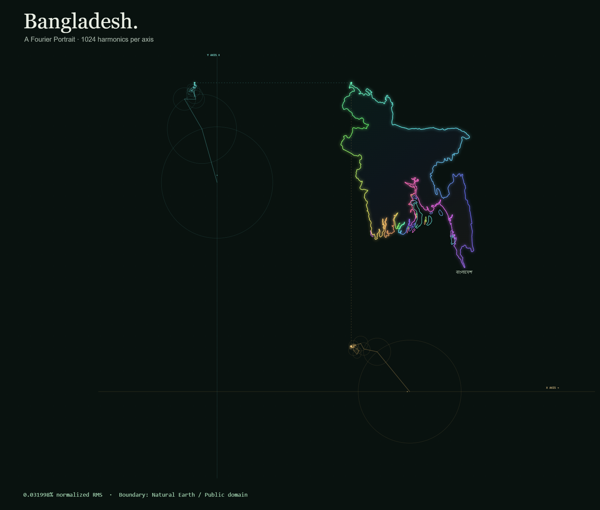

# Bangladesh — A Fourier Portrait

A colourful, interactive portrait of Bangladesh drawn with actual Fourier epicycles. The horizontal coordinate comes from the **X circles on the bottom axis**; the vertical coordinate comes from the **Y circles on the left axis**. Their projected endpoints meet on the map. The circles stay outside the map throughout their rotations.

**[Live demo](https://almuzahidseyam.github.io/bangladesh-fourier-epicycles/)** · **[RMS analysis](rms-analysis.json)**



## Explore

- **N = 2–1024** harmonics per axis; default N=1024, with 128 / 512 / 1024 presets.
- A luminous spectrum follows the mainland border; coastal islands reveal themselves alongside it.
- X and Y epicycles occupy separate axes with a guaranteed gap from the map.
- **Focus on map** enlarges the border without the circles. Switch back with **Show axes**.
- Play / pause, restart, 0.25×–2× speed, and a timeline to inspect any position.
- Progressive detail doubles N each cycle until 1024.
- A logarithmic RMS convergence chart and **Find minimum RMS** button.
- High-resolution PNG export and fullscreen where supported.
- Responsive layout, keyboard controls, and reduced-motion support.

## Run

Open `dist/index.html` directly in a browser. No dependencies, installation, API keys, or build step are required. All drawing data is included; optional Google Fonts fall back to system fonts offline.

Alternatively, from the repository root:

```sh
python -m http.server 4173 --directory dist
```

Then open http://localhost:4173. Space toggles playback outside controls; the range inputs support arrow keys and Home / End.

## What N=1024 actually means

The detailed **Natural Earth 1:10m v5.1.2** Bangladesh geometry has 2,280 exterior vertices across 22 polygons. The largest polygon is the mainland. Its exterior is projected locally, centered, and sampled at **8,192 equal arc-length positions**, safely above the minimum required for 1,024 distinct positive frequencies. A radix-2 FFT creates the coefficients of each real coordinate series:

```text
f(t) = a₀ + Σ [aₖ cos(kt) + bₖ sin(kt)]
```

An inverse FFT reconstructs **16,384 positions per cycle**, so high-frequency detail is retained in the rendered line. Tiny circles can fall below a screen pixel and are omitted visually; every selected coefficient still contributes to the position. Offshore islands are coloured reference outlines, not part of the mainland's Fourier error metric.

## RMS study

Every integer **N=2…1024** was evaluated. Error is the root-mean-square Euclidean reconstruction distance divided by the mainland samples' RMS radius about their centroid, expressed as a percentage. Parseval's theorem gives the same residual as direct reconstruction; the checks compare both methods. More orthogonal frequencies reduce this sampled RMS monotonically.

| Harmonics per axis | Sampled normalized RMS | Independent midpoint RMS |
| ---: | ---: | ---: |
| 128 | 0.719306% | 0.719405% |
| 256 | 0.300928% | 0.300955% |
| 512 | 0.105006% | 0.105053% |
| 768 | 0.052810% | 0.052981% |
| **1024** | **0.031998%** | **0.032293%** |

**N=1024 is the minimum within the tested range.** It does not produce exact zero error. The independent validation uses another 8,192 points halfway between the training positions on the original source polyline. This measures reconstruction of this boundary dataset, not real-world geographic accuracy. The complete 1,023-value convergence curve and validation results are in [`rms-analysis.json`](rms-analysis.json).

## Why circles cannot enter the map

The layout calculates an envelope containing every circle, over the entire cycle, including its radius. Bounds between sampled phases include a derivative-based margin. The X chain is placed below the map's lowest reference/reconstructed point; the Y chain is placed to the left of its leftmost point. Both retain an additional gap equal to 18% of the normalized mainland height. Projection lines connect the separated circles to the drawing point.

## Reproduce the checks

```sh
python prepare-boundary.py
node check-math.cjs
node check-interactions.cjs
```

The checks verify known signals, FFT/direct-series agreement, Nyquist protection, periodic closure, every tested RMS value's monotonicity, independent midpoint error, circle separation at off-grid phases, reduced motion, progressive detail, scrubbing, and pause/restart behavior. The numerical check regenerates `rms-analysis.json`.

## Files

- `dist/`: browser-ready HTML, CSS, FFT implementation, drawing engine, and boundary asset.
- `boundary-natural-earth.geojson`: pinned Bangladesh source geometry.
- `prepare-boundary.py`: standard-library asset and independent validation sample generator.
- `check-math.cjs`: numerical and layout verification.
- `check-interactions.cjs`: animation/control regression checks with a simulated clock.
- `validation-samples.json`: independent midpoint reference positions.
- `rms-analysis.json`: exhaustive convergence report.

## Data credits

Made with [Natural Earth](https://www.naturalearthdata.com/downloads/10m-cultural-vectors/10m-admin-0-countries/). Its map data is [public domain](https://www.naturalearthdata.com/about/terms-of-use/). The Bangladesh feature is extracted from the [v5.1.2 countries GeoJSON](https://raw.githubusercontent.com/nvkelso/natural-earth-vector/v5.1.2/geojson/ne_10m_admin_0_countries.geojson). This is an artistic study of generalized geographic data. No third-party data licence is applied to the application source code.
